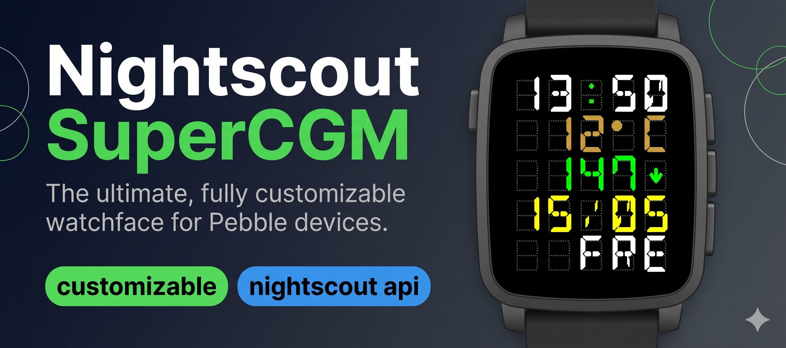
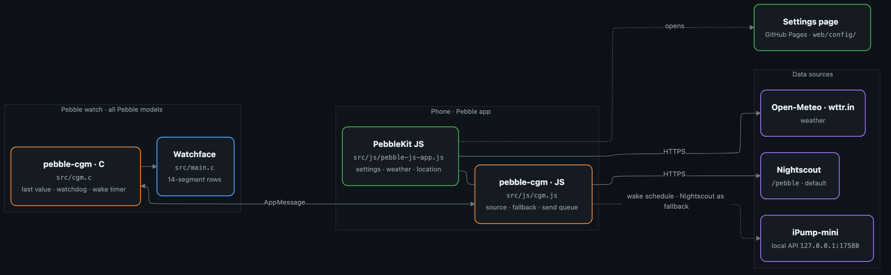

# Nightscout-supercgm

[English](README.md) · **Deutsch**

Ein flexibles Pebble-Watchface für **CGM und Wetter** mit frei belegbarem 5er-Raster pro Zeile – für farbige und schwarz-weiße Pebbles, auch die runden Modelle.

**Status:** im Pebble Appstore · Daten aus Nightscout oder [iPump-mini](https://github.com/sgitaize/iPump-mini) · alle Pebble-Modelle · wird aktiv gepflegt

## So kommst du dran

| | |
|---|---|
| **Pebble Appstore** | [supercgm-ns](https://apps.rePebble.com/68c5e8d5474b97000932ae2c) – über die Pebble-App auf dem Handy installieren |
| **Releases** | [`.pbw` auf GitHub](https://github.com/sgitaize/Nightscout-supercgm/releases/latest) zum Seitenladen |
| **Einstellungen** | Zahnrad in der Pebble-App → [Einstellungsseite](https://sgitaize.github.io/Nightscout-supercgm/config/) (Deutsch / Englisch) |

## Funktionen

- **Frei belegbare Zeilen** – pro Zeile eins von: Wetter · Uhrzeit · Datum · Wochentag · Akku · BZ · Schritte · Puls · BZ-Zeit · BZ-Delta · Regen in den nächsten 3 h
- **Zwei CGM-Quellen:** Nightscout (`/pebble`, Standard) oder [iPump-mini](https://github.com/sgitaize/iPump-mini), die iPhone-App, die eine MiniMed 780G direkt ausliest – ganz ohne Internet; Nightscout kann als Ersatz einspringen (kleine Wolke)
- **Akkuschonender Abgleich** direkt nach jedem neuen Wert; mit iPump-mini im Weckrhythmus der App, und die Uhr stößt das Handy an, wenn es still bleibt
- **Farben pro Zeile**, dazu Farben für im Ziel / hoch / niedrig und eine Farbe für das Geister-Raster
- **Geister-Darstellung je Plattform** – sichtbare Geisterfarbe auf Farb-Pebbles, dezentes Punktraster auf Aplite, graue Geister auf Diorite; Dichte von 1 bis 5 einstellbar
- **Wetter über Open-Meteo** (ohne API-Schlüssel, °C/°F) mit Regenwahrscheinlichkeit für die nächsten 3 Stunden
- **Einstellungsseite mit Live-Simulator** – Uhrform, Zeilentypen und -farben, Beispielwerte, Rasterdichte und Umschalter für die Schüttel-Ansicht, in einer DSEG-Schrift nah an der echten Uhr
- **Dauerhaft gespeichert** auf Uhr und Handy; der letzte BZ-Wert übersteht einen Neustart

### Alarme & Verhalten
- **Vibration bei niedrigem BZ** – 3 kurze Pulse, **bei hohem BZ** – 2 Pulse (jeweils einstellbar, 10 Minuten Pause)
- **Licht beim Schütteln** (ab Pebble Time)
- **Bluetooth weg** – ein kurzes Vibrieren und **NOCON** auf dem Display

### Schütteln für mehr
Schütteln oder Antippen blendet 5 Sekunden lang Zusatzinfos ein: Schritte · Akku · Puls · BZ · **BZ-Zeit** · **BZ-Delta** · **Regen in 3 h**. Auf der Einstellungsseite gibt es eine Vorschau dafür, so lässt sich die zweite Ebene vor dem Speichern prüfen.

## Plattformen

| Plattform | Display | Zeilen |
|---|---|---|
| Basalt (Pebble Time) | Farbe | 5 |
| Chalk (Pebble Time Round) | Farbe, rund | 4 |
| Gabbro (Pebble Round 2) | Farbe, rund | 5 |
| Emery (Pebble Time 2) | Farbe | 5 |
| Flint (Pebble 2 Duo) | S/W | 5 |
| Aplite (Pebble / Pebble Steel) | S/W | 5 |
| Diorite (Pebble 2) | S/W | 5 |

## Architektur

<p align="center"></p>

<sub>Quelle: <a href="docs/architecture.mmd">docs/architecture.mmd</a> (Mermaid)</sub>

**So funktioniert es**
- **Die Uhr zeichnet, das Handy holt die Daten.** Der C-Code zeichnet die Zeilen und merkt sich den letzten Wert; das JavaScript in der Pebble-App (PebbleKit JS) spricht mit dem Internet und schickt kompakte AppMessages.
- **pebble-cgm** übernimmt alles rund um CGM auf beiden Seiten: Quelle wählen, Abruf passend nach jedem neuen Wert, Weckplan von iPump-mini, Ersatz durch Nightscout, Sendewarteschlange mit Bestätigung und ein Wächter auf der Uhr. Dieselbe Bibliothek läuft in [CasioCGM](https://github.com/sgitaize/casiocgm) und [91 Dub CGM](https://github.com/sgitaize/dubv4cgm).
- **Die Einstellungen** sind eine statische Seite auf GitHub Pages; die Konfiguration reist im URL-Fragment, dein Nightscout-Token erreicht also nie einen Server.
- **Layout je Plattform:** eckige Modelle bekommen 5 Zeilen, die erste runde Pebble 4 mit engerem Abstand, die Round 2 ein eigenes rundes Layout.

| Baustein | Ort | Aufgabe |
|---|---|---|
| Watchface | `src/main.c` | Zeilen, Geister-Raster, Farben, Schütteln, Speichern |
| CGM (Uhr) | `src/cgm.c` | letzter Wert, Status, Wächter, Weck-Timer (aus pebble-cgm) |
| Handy-Skript | `src/js/pebble-js-app.js` | Einstellungen, Wetter, Standort, Nachrichten an die Uhr |
| CGM (Handy) | `src/js/cgm.js` | Nightscout / iPump-mini, Zeitplan, Ersatzquelle (aus pebble-cgm) |
| Einstellungsseite | `web/config/` | Simulator, Deutsch / Englisch, veröffentlicht über `.github/workflows/pages.yml` |
| Nachrichten-Schlüssel | `package.json` → `pebble.messageKeys` | einzige Quelle für die Schlüssel zwischen Uhr und Handy |
| Store-Eintrag | `store/` | Beschreibung, Screenshots, `publish.sh` |

## Einstellungen

Die Einstellungen öffnest du in der Pebble-App. Die [Einstellungsseite](https://sgitaize.github.io/Nightscout-supercgm/config/) passt sich der Plattform an (Zeilenzahl, S/W-Palette, Geister-Sichtbarkeit, Vorschau); Voreinstellungen gibt es für die älteren Modelle sowie Time 2 und Round 2. Standardsprache ist Englisch, Deutsch per Umschalter.

**CGM:** Nightscout oder iPump-mini wählen. Für Nightscout die Basis-Adresse eintragen (die App fragt `<URL>/pebble` ab) und optional ein Token; bei iPump-mini lässt sich Nightscout als Ersatz einschalten.

- kein BZ vorhanden → **NO-BG**, Verbindung weg → **NOCON**, veraltet → **OLD-BG**, iPump-mini läuft nicht → **NOAPP**
- Trendpfeile werden direkt gezeichnet (↑, ↗, →, ↘, ↓ und doppelte); das Delta stammt aus `bgs[0].bgdelta`
- Der Abruf richtet sich nach der Serverzeit `status[0].now` und dem Zeitpunkt des Werts `bgs[0].datetime` (`datetime + Intervall + 30 s`)

## Bauen & entwickeln

Voraussetzung: Pebble SDK 4.33 (`pebble`-Befehl, pebble-tool 5).

```bash
pebble build                          # App + erzeugte Nachrichten-Schlüssel
pebble install --phone <HANDY_IP>     # aufs Handy
pebble install --emulator emery       # Time 2 · auch chalk, gabbro, diorite, aplite …
```

Änderungen unter `web/` auf `main` gehen automatisch auf GitHub Pages. Die Uhr übergibt ihre Einstellungen im URL-Fragment (`#config=…`), die Seite zeigt sie also auf jedem Host. Versionen vor 2.4 öffnen noch die alte Seite unter supercgm-config.aize-it.de/config20.

## Status & Pläne

- **Live:** 2.8 im Pebble Appstore (Nightscout und iPump-mini, Stabilitäts-Fixes aus pebble-cgm 1.1.0).
- Ideen, Fehlerberichte und Pull Requests sind willkommen – gerne als [Issue](https://github.com/sgitaize/Nightscout-supercgm/issues).

## Unterstützen

Wenn dir das Watchface 50 Blicke aufs Handy am Tag erspart – kauf mir eine Paulaner Spezi!

<p align="center">
  <a href="https://www.paypal.com/donate/?hosted_button_id=LGAZB9PR4YV5L">
    
  </a>
</p>

## Dank

Rund 90 % des Codes sind im Pair-Programming mit KI-Assistenten entstanden (GitHub Copilot mit Claude, später [Claude Code](https://claude.com/claude-code)) – das macht es leicht erweiterbar.

## Lizenz

[MIT](LICENSE.txt) – frei nutzbar, veränderbar und weitergebbar im Rahmen der Lizenz.
